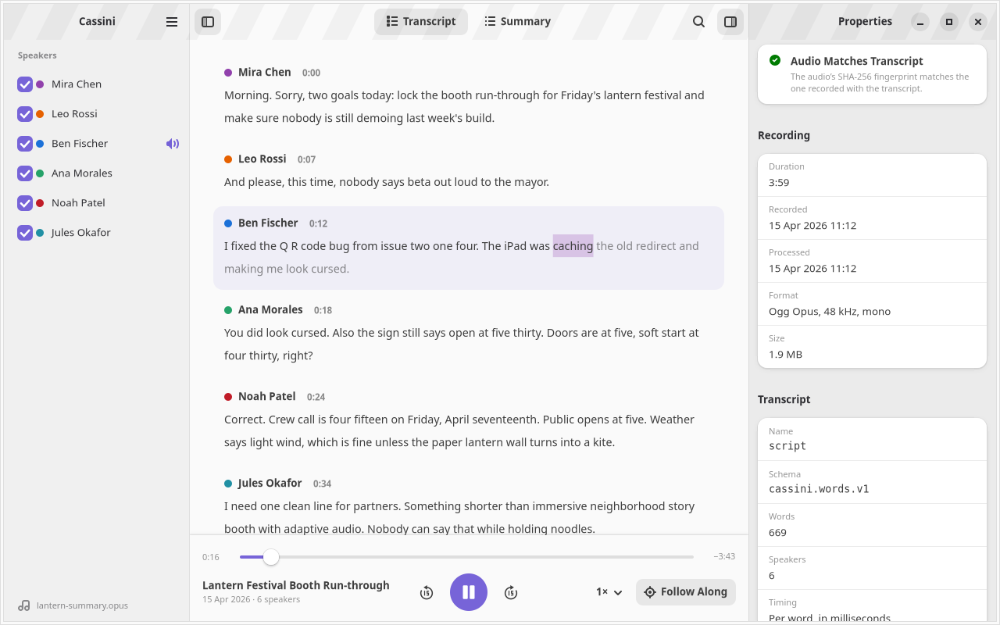

# Cassini for GNOME

Play meeting recordings and read along with the transcript stored inside them.



Cassini opens [Cassini portable meetings](https://format.gocassini.com/):
ordinary Ogg Opus files whose comment header also carries a word-timed
transcript, the speakers and, optionally, a summary. Any audio player can play
them. Cassini also shows the transcript.

- The spoken word is highlighted during playback, and the view follows it
- Click any word or timestamp to play from there
- Show or hide speakers, and switch between transcripts when a file has several
- Search the transcript
- Read the summary and jump to its action items and topics
- Check that the audio still matches the transcript recorded with it
- Export the transcript as plain text or WebVTT subtitles
- Plain `.opus` files play without a transcript

It is a GTK 4 and libadwaita application written in Python, with GStreamer
for playback.

## Install

Builds of every commit are attached to the
[CI runs](https://github.com/codemyriad/cassini-gnome/actions), and tagged
versions to the [releases](https://github.com/codemyriad/cassini-gnome/releases):

- **Debian and Ubuntu**: `sudo apt install ./cassini-viewer_*_all.deb`.
  Needs libadwaita 1.8 or newer: Ubuntu 26.04, Debian forky.
- **Flatpak**: `flatpak install --user cassini-viewer.flatpak`. Uses the
  GNOME 50 runtime from Flathub.

## Build from source

You need Meson, Python 3.11+, PyGObject, GTK 4.18+, libadwaita 1.8+ and
GStreamer with the base and good plugins.

```sh
meson setup _build --prefix="$PWD/_install" -Dprofile=development
meson install -C _build
meson test -C _build
GSETTINGS_SCHEMA_DIR=_install/share/glib-2.0/schemas _install/bin/cassini-viewer recording.opus
```

Or build the Flatpak with GNOME Builder, or:

```sh
flatpak-builder --user --install --force-clean _flatpak build-aux/flatpak/com.gocassini.Viewer.Devel.json
```

To build the Debian package in a container: `build-aux/deb/build.sh`. The
package lands in `dist/`.

## The format

The reader in [`src/cassini_viewer/portable.py`](src/cassini_viewer/portable.py)
follows the [specification](https://format.gocassini.com/) and has no GTK
dependency. It reports the specification's trust states (`ok`, `stale-audio`,
`unverified`, `invalid-cassini-metadata`, …), and it verifies the
`exact-opus-audio-v1` digest of the audio packets in a background thread.
It passes the format's
[conformance vectors](https://github.com/codemyriad/cassini-format/tree/main/spec/conformance),
vendored in [`tests/conformance`](tests/conformance).

## Contributing

Bug reports and pull requests are welcome. See [CONTRIBUTING.md](CONTRIBUTING.md).
This project follows the [GNOME Code of Conduct](CODE_OF_CONDUCT.md).

## License

Cassini for GNOME is free software, licensed under the
[GNU General Public License, version 3 or later](COPYING).
The conformance vectors in `tests/conformance` are CC0-1.0.
