# Cassini

Cassini is a GNOME desktop app for Linux that records your meetings, writes them down, and lets you read and search them on this computer.

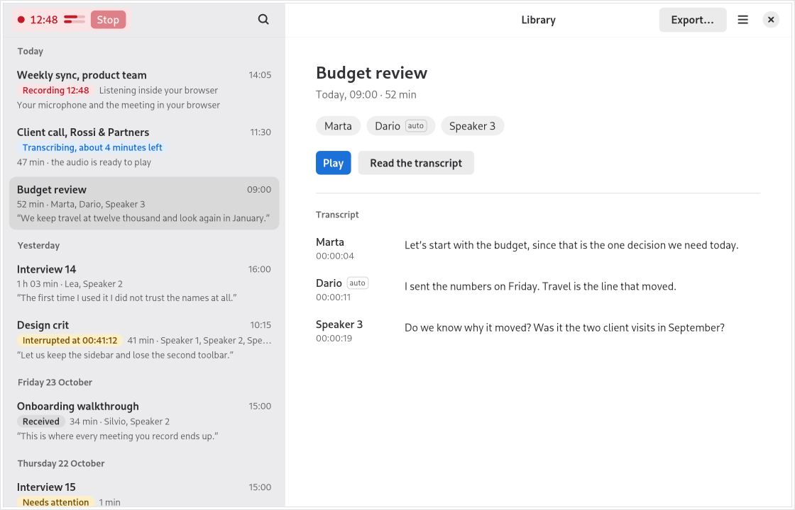

*The Library with sample meetings.*

## What you can do

- Record a meeting from your microphone and this computer's sound (the others) straight into your Library with one press of **Record**, and change whether you record **Me**, **The others**, or **Both** at any point during the meeting.
- Write meetings down automatically on this computer, offline, using the included **Whistle** speech model or the optional **Parakeet Ultra** model (25 European languages), and optionally **Tell speakers apart** as **Speaker 1**, **Speaker 2**, and so on.
- Read a meeting while you listen, with each word highlighted as it plays and any word clickable to play from that moment.
- Name speakers in a meeting, remember their voice on this computer so future meetings name them automatically, listen to a short voice sample before naming, merge speakers who are the same person, and undo a merge if needed.
- Search every meeting for a phrase and filter results by speaker, date, or meetings you recorded yourself.
- Open Cassini `.opus` files from elsewhere on your computer to keep a copy in your Library as a **Received** meeting.
- Export any meeting to share or back up, either as a portable Cassini `.opus` audio file or as a Markdown text file.
- Record calls in Chrome, Chromium, Edge, or Brave so each person in the call is kept apart in the transcript.

## Get started

### Install

Packages are on the [Releases page](https://github.com/codemyriad/cassini-gnome/releases). The latest release, [v0.3.0](https://github.com/codemyriad/cassini-gnome/releases/tag/v0.3.0), has `.deb` packages for Ubuntu 26.04 and Debian testing, Fedora and openSUSE Tumbleweed `.rpm` packages, an Arch package, and a Flatpak. You can also download test packages built from `main` on each successful [CI run](https://github.com/codemyriad/cassini-gnome/actions/workflows/ci.yml?query=branch%3Amain) (a GitHub account is needed to download them), or build from source ([CONTRIBUTING.md](CONTRIBUTING.md)).

Native packages need GTK 4.18 and libadwaita 1.8 or newer (Debian testing, Ubuntu 26.04, Fedora 43 and later, openSUSE Tumbleweed, and Arch Linux). On older distributions (Debian 13, Ubuntu 24.04, openSUSE Leap, and RHEL), use the Flatpak. The test packages built from `main` are for 64-bit Intel and AMD (`x86_64`) computers: `.deb` packages for Ubuntu 26.04 and Debian testing, Fedora and openSUSE RPMs, an Arch package, and the Flatpak.

- **Flatpak** (uses the GNOME 50 runtime from Flathub):

  ```sh
  flatpak install --user cassini-talk.flatpak
  ```

- **Debian and Ubuntu**:

  ```sh
  sudo apt install ./cassini-talk_*.deb
  ```

- **Fedora**:

  ```sh
  sudo dnf install ./cassini-talk-*.rpm
  ```

- **openSUSE Tumbleweed**:

  ```sh
  sudo zypper install ./cassini-talk-*.rpm
  ```

- **Arch Linux**:

  ```sh
  sudo pacman -U cassini-talk-*.pkg.tar.zst
  ```

### Your first meeting

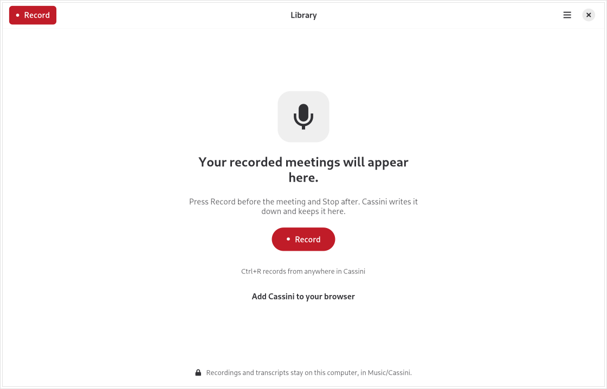

*The Library before your first meeting.*

Press **Record** in the Library (or press `Ctrl+R` anywhere in Cassini). Cassini starts recording your microphone and this computer's sound (the others) together, straight into the Library, without asking where to save a file. If you have set up the browser companion and a browser meeting is open, **Record** records that browser meeting instead.

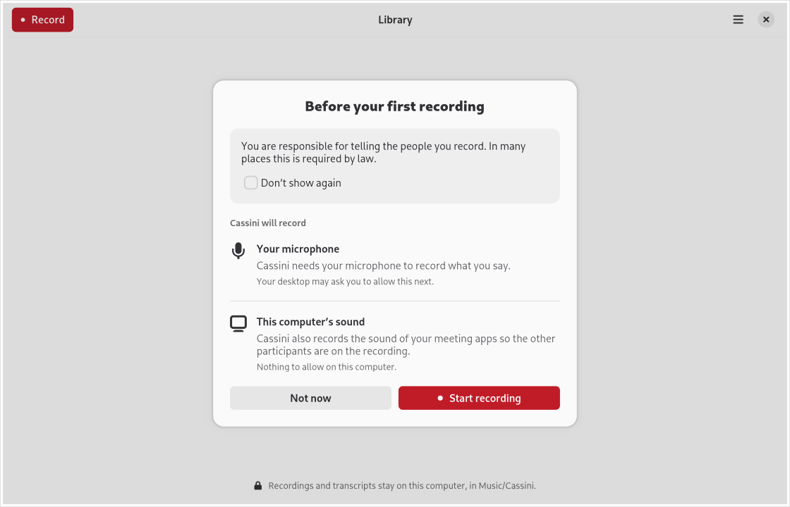

*The Before your first recording card shown the first time you press Record.*

The first time you record, a **Before your first recording** card reminds you that you are responsible for telling the people you record and explains what will be recorded. Choose **Don't show again** to hide the card next time (you can turn it back on any time in **Preferences** > **Recording**). Your desktop may also ask you to allow Cassini to use your microphone.

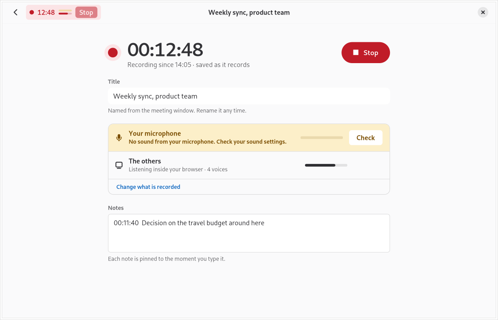

*The Recording page during a sample meeting, with a silent-microphone warning and a time-pinned note.*

While recording, the Recording page shows a large timer, live sound levels for your microphone and the others, an editable **Title**, and a **Notes** box. Each line you type in **Notes** is pinned to the moment you start typing it. If your microphone is silent for 20 seconds, Cassini shows a warning with a **Check** button that opens your sound settings. If a microphone or computer sound briefly stops delivering audio for a second or more, Cassini keeps the meeting's timing by recording that moment as silence, so the transcript stays in step.

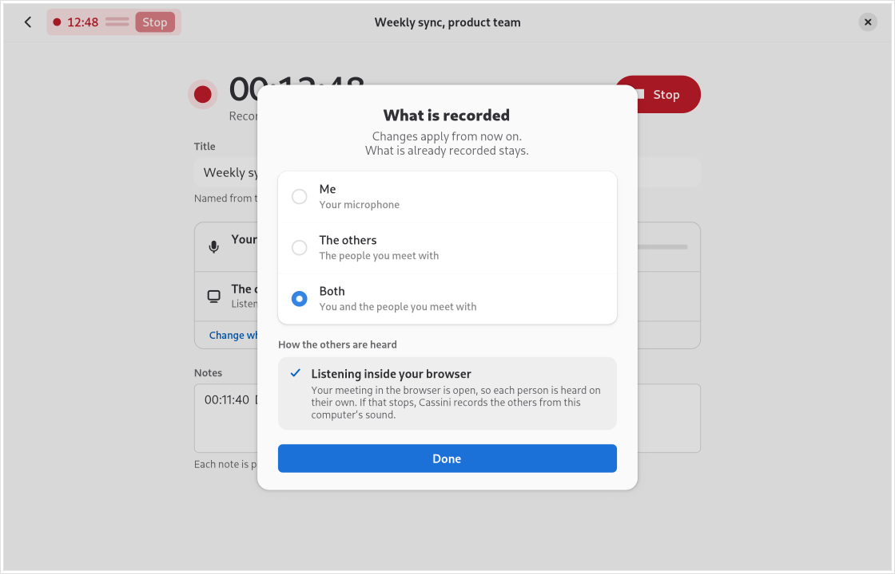

*Choosing what is recorded during a meeting.*

Press **Change what is recorded** on the Recording page to choose **Me** (your microphone only), **The others** (the people you meet with), or **Both** at any point during the meeting. Changes apply from that moment on, and everything already recorded is kept. The dialog also shows how the others are heard: **Listening inside your browser** when recording a browser call, or **This computer's sound** when recording what your computer plays (which follows your speaker volume and mute). If a browser meeting can no longer be reached—for example, if the tab is reloaded or closed, or the browser quits—Cassini continues recording the others from this computer's sound until you stop, and shows a **Why?** button explaining what happened.

Recording keeps going if you return to the Library. If you close the window, Cassini asks whether to **Stop and keep it** or **Keep recording** in the background. While Cassini is hidden, a desktop notification shows the active recording with **Stop** and **Open Cassini** buttons. You can also press `Ctrl+Alt+R` to start or stop recording from anywhere on the desktop (GNOME asks you to allow this shortcut the first time, and you can change the shortcut in **Preferences** > **Recording**). Your computer will not go to sleep while Cassini is recording. If disk space runs low, Cassini warns you; if it gets too low, Cassini stops recording and keeps everything recorded so far.

When the meeting ends, press **Stop** on the Recording page, in the red pill in the Library header, or in the desktop notification (or hang up the call in your browser). The Library shows the meeting saving, and then begins writing it down.

### Read and search your meetings

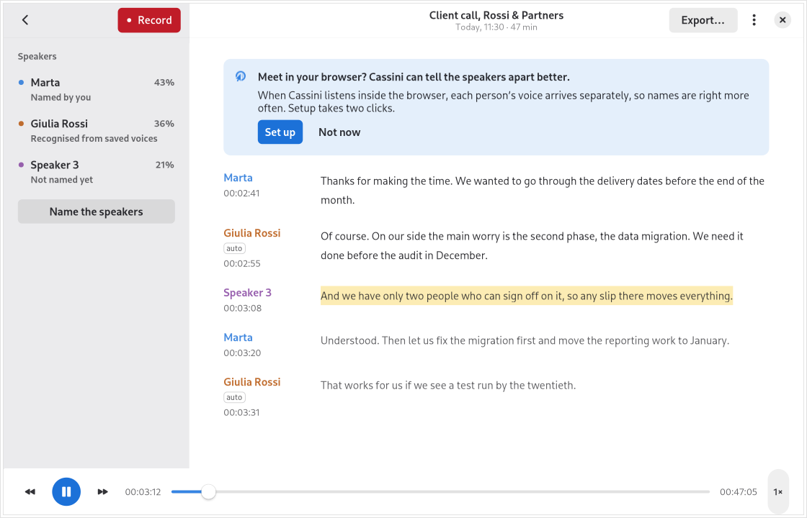

*A meeting page with a sample meeting.*

When a recording stops, Cassini writes it down automatically on this computer, offline. The Library shows progress and an estimate of the time left. If you close Cassini, it continues next time you open the app; if writing down fails, press **Try again**. Older recordings and Received meetings without a transcript have a **Write it down** button. Writing down is available on `x86_64` (64-bit Intel and AMD) computers in both the native packages and the Flatpak; on other computers, the **Write it down** button is hidden.

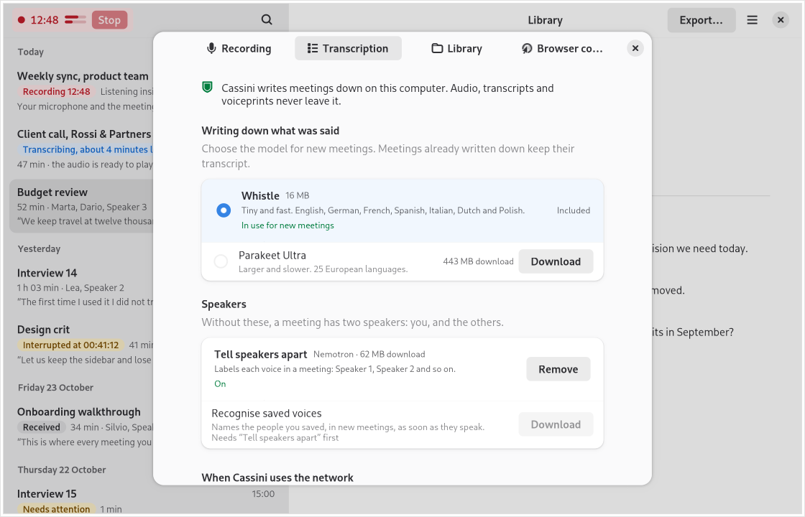

*Preferences (`Ctrl+,`) on the Transcription tab, over sample meetings in the Library.*

Open **Preferences** from the main menu or with `Ctrl+,` to see the **Recording**, **Transcription**, **Library**, and **Browser companion** tabs. In **Transcription**:

- **Writing down what was said**: **Whistle** (16 MB) is included and used by default for English, German, French, Spanish, Italian, Dutch, and Polish. You can also download the optional **Parakeet Ultra** speech model (443 MB download, 25 European languages) and choose it for new meetings. Meetings already written down keep their transcript; if you remove Parakeet Ultra later, existing transcripts and speaker names stay and new meetings use Whistle again.
- **Speakers**: Without extra speaker models, a meeting recorded from your microphone and computer sound attributes words to **Me** and **The others** (while browser recordings already keep each participant apart as **Speaker 1**, **Speaker 2**, and so on). Download **Tell speakers apart** (Nemotron, 62 MB download) to separate voices that share a microphone or computer sound source: once **On**, it labels each voice as **Speaker 1**, **Speaker 2**, and so on in meetings written down from then on, leaving existing transcripts as they are. Below it, **Recognise saved voices** (26 MB download) can be downloaded once **Tell speakers apart** is **On**: when **On**, Cassini names people you saved in meetings written down from then on. Below it, a **Saved voices** row shows how many people are saved and opens the **Saved voices** page.

In the Library, meetings are grouped by day with a quote, the speakers, and a short transcript preview. You can start playback straight from the preview, or open the meeting to see each speaker's share of the conversation and read the full transcript. As the meeting plays, words are highlighted and the transcript scrolls along. Click any word to play from that moment, use the player bar to skip 10 seconds back or forward, or press `Space` to play and pause.

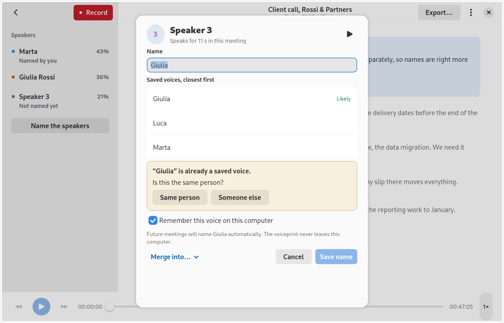

*Naming a speaker in a sample meeting.*

To name someone in a meeting, click their row in the **Speakers** sidebar (or press **Name the speakers**). Press the play button in the dialog to listen to a short sample of their voice from the meeting, type their **Name**, and press **Save name**. When you name a speaker, keep **Remember this voice on this computer** checked (it needs a few seconds of that person speaking on their own) so future meetings name them automatically when Cassini is confident. When it is less sure, the dialog lists **Saved voices, closest first** with the closest marked **Likely**, so you can pick the name. If you type a name that is already saved, Cassini asks whether it is the same person (**Same person** or **Someone else**). You can also rename **Me** and **The others**, or clear a name to return to **Speaker 1**, **Speaker 2**, and so on. A name recognised automatically can be changed or cleared like any other, and a name you clear stays cleared: Cassini does not put it back. If one person was split into two speakers, choose **Merge into…** and pick the other speaker to combine their turns; to undo the last merge, open the meeting menu (the three-dots button in the meeting header) and choose **Undo merge**. Merging and undoing a merge keep saved voices up to date. Speaker names and merges apply everywhere in Cassini, including the Library, **Search every meeting**, and exported files.

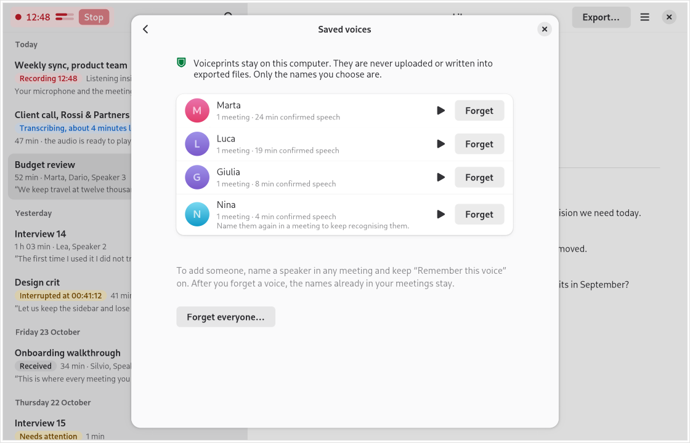

*The Saved voices page with sample voices.*

**Recognise people automatically.** On the **Saved voices** page (opened from **Preferences** > **Transcription**), Cassini lists each person you saved with how many meetings they were recognised or named in and how much confirmed speech Cassini has heard. Press the play button next to a person to play a short sample (up to 10 seconds) from their most recent meeting still in the Library. Press **Forget** to remove one person, or **Forget everyone…** to remove all of them after a confirmation. Forgetting never changes names already in your meetings.

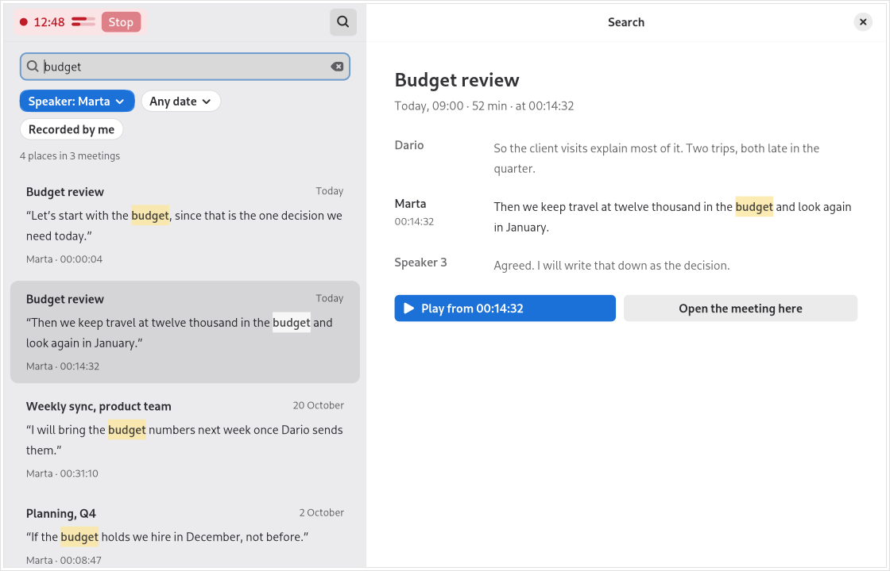

*Search every meeting with sample meetings.*

To find something across all of your meetings, press the magnifier in the Library or press `Ctrl+F` to open **Search every meeting**. Type a phrase to find every matching moment. You can narrow results by **Speaker** (when a meeting has named speakers), by date (**Today**, **Past 7 days**, or **Past 30 days**), and with **Recorded by me**. Each result shows the words around the match: press **Play from** to listen right there, or **Open the meeting here** to jump to that point in the full transcript. Filters reset when you close Search. The search index is private, kept in Cassini's cache folder, and never written into your Library.

### Open meetings you receive

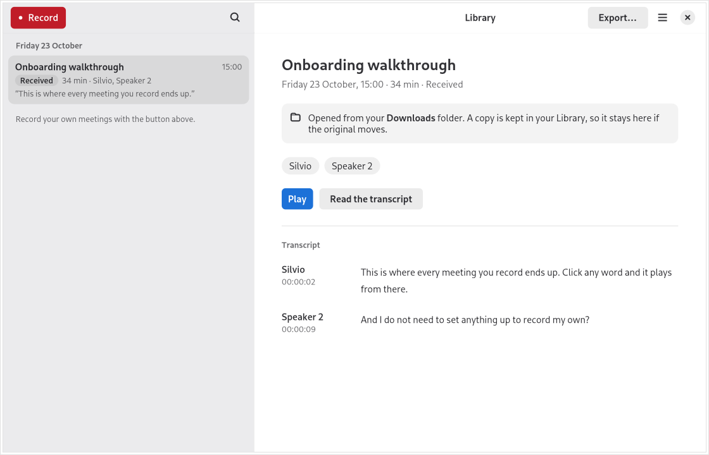

*A sample meeting in the Library marked as `Received`.*

When someone sends you a Cassini `.opus` meeting file, you can open it by choosing **Open…** in the main menu (`Ctrl+O`), opening the file with Cassini from your file manager, or dragging and dropping it onto the Library window.

Cassini copies the file into your Library and marks it as **Received**. Your original file is left untouched, and the copy in your Library stays even if you move or delete the original. Opening the same file a second time opens the existing copy instead of creating a duplicate.

### Export a meeting

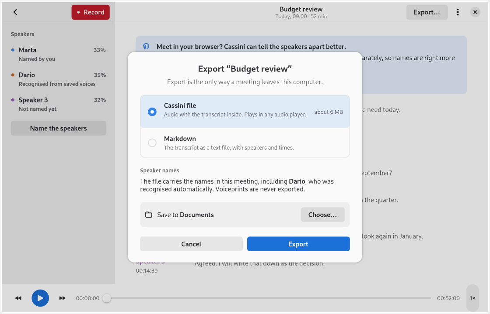

*The Export dialog over a sample meeting.*

To share a meeting or back it up elsewhere, press **Export…** in the Library header, in the meeting header, or in the main menu (or press `Ctrl+Shift+E`). You can export in two formats:

- **Cassini file**: a `.opus` audio file with the transcript, speakers, and notes inside, which plays in any audio player.
- **Markdown**: the transcript as a plain text `.md` file with speakers, times, and your notes.

Cassini saves exported files to your **Documents** folder unless you choose another folder, and never overwrites an existing file. **Export** is the only way a meeting leaves this computer. Voiceprints are never exported.

### Record meetings in your browser

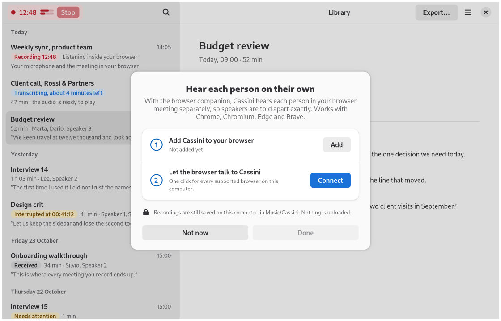

*The two-step browser companion setup dialog.*

In **Chrome**, **Chromium**, **Edge**, and **Brave**, Cassini can record calls directly from your browser so each person in the call is heard on their own and kept apart as **Speaker 1**, **Speaker 2**, and so on. Browser recording works in both the native packages and the Flatpak.

You set up the browser companion from inside Cassini—open **Preferences** (`Ctrl+,`) > **Browser companion** and press **Set up**, press **Set up** on the suggestion card in a meeting, or press **Add Cassini to your browser** on the empty Library screen before your first recording. Setup is per user, for your own browser profiles, and never system-wide:

1. **Add Cassini to your browser**: press **Add** to open the Cassini Recorder page in the Chrome Web Store. *(The Chrome Web Store listing is not public yet; the extension will be available there with the next release. For local builds and developer testing before then, see the [browser companion guide](browser-extension/README.md).)*
2. **Let the browser talk to Cassini**: press **Connect**. One click connects every supported browser installed on this computer (**Chrome**, **Chromium**, **Edge**, and **Brave**). When Cassini and the browser are connected, press **Done**.

Once connected, pressing **Record** in Cassini records every browser meeting that is currently open, saving each call as its own meeting in your Library. You can stop a call from its Recording page, or hang up the call in your browser to stop and save it automatically; pressing **Stop** in the Library header pill, in the desktop notification, or with `Ctrl+Alt+R` stops all active recordings.

In **Preferences** (`Ctrl+,`) > **Recording**, you can also turn on **Record every browser meeting automatically** (off by default). Cassini then starts recording whenever you join a browser call, even if the Cassini window is closed, and shows a desktop notification with a **Stop** button.

For local builds, whole-tab audio capture, and troubleshooting, see the [browser companion guide](browser-extension/README.md).

## Your meetings stay on this computer

Cassini stores your Library in `Music/Cassini` inside your home folder (`~/Music/Cassini`), with one folder per meeting. In **Preferences** (`Ctrl+,`) > **Library**, press **Show in Files** to open the folder in your file manager, or **Move…** (in the native packages) to move your Library to another folder.

Everything happens on this computer: recording, writing meetings down offline, telling speakers apart, recognising saved voices, and searching across your Library. Cassini only uses the network when you ask it to download an optional speech or speaker model in **Preferences** > **Transcription**. There is no account, no cloud service, and nothing is uploaded. **Export** is the only way a meeting leaves this computer, and only when you choose. Voiceprints stay on this computer, in Cassini's own private data folder, not in the Library. They are never uploaded and never written into exported files; only the names you choose are.

Exported and Received [portable meetings](https://format.gocassini.com/) are ordinary `.opus` audio files that carry their transcript, speakers, and notes inside the file itself, and play in any audio player.

## Help and feedback

If you run into a problem or want to suggest an improvement, open an issue on [GitHub Issues](https://github.com/codemyriad/cassini-gnome/issues). Please include your Linux distribution and how you installed Cassini.

## For developers

To build Cassini from source, run the tests, or build packages, see [CONTRIBUTING.md](CONTRIBUTING.md). Technical documentation and specifications are in [`docs/`](docs/).

## License

Cassini for GNOME is free software, licensed under the [GNU General Public License, version 3 or later](COPYING). The conformance vectors in `tests/conformance` are CC0-1.0.
